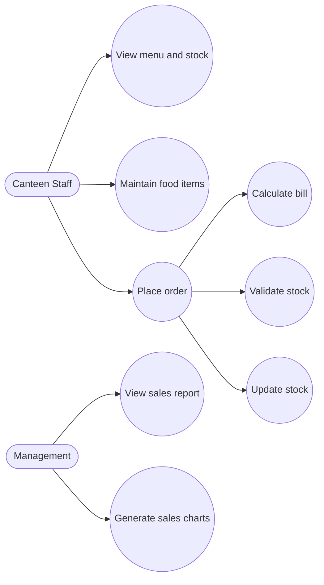
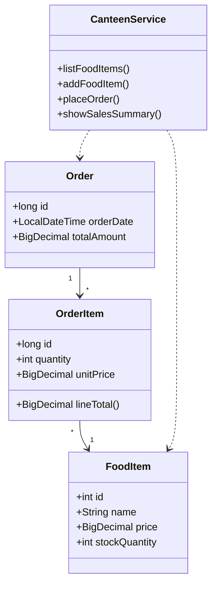
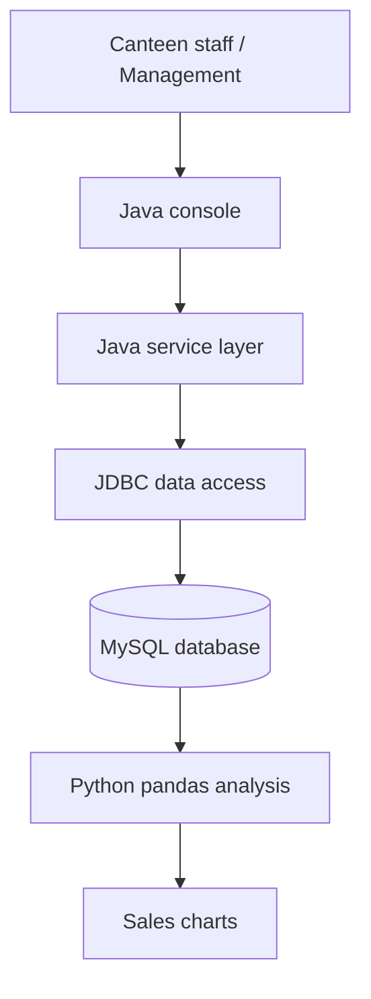
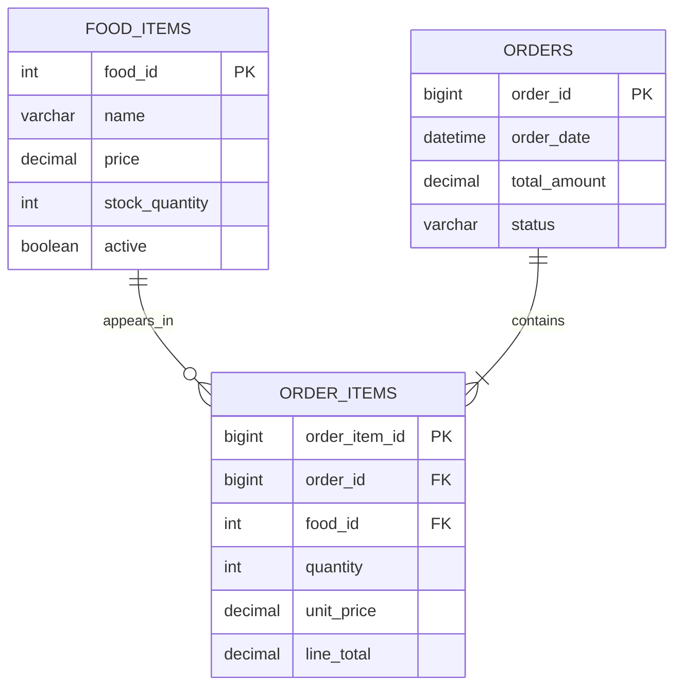

# System Design Diagrams
These Mermaid diagrams can be previewed in VS Code with a Mermaid extension and exported as images if required.

## Use Case Diagram

## Class Diagram

## System Architecture

## ER Diagram

